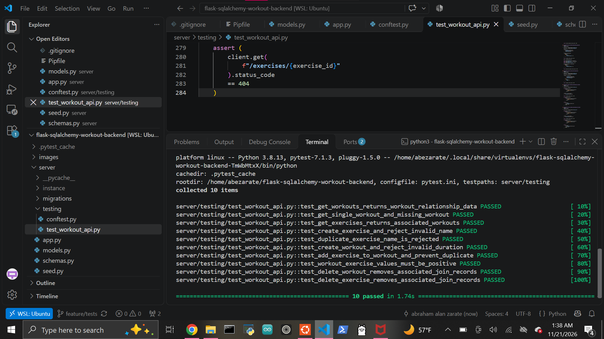

# Flask SQLAlchemy Workout Application Backend

A RESTful backend API for a workout tracking application built with Flask, SQLAlchemy, Flask-Migrate, and Marshmallow.

The application allows personal trainers to create and view workouts, create and view exercises, associate exercises with workouts, record workout-specific exercise data such as sets, repetitions, and duration, and delete workouts or exercises.

## Features

- Create, view, and delete workouts
- Create, view, and delete exercises
- Add exercises to workouts through a `WorkoutExercise` join model
- Record sets, repetitions, and duration for exercises within a workout
- Serialize related workout and exercise data with Marshmallow
- Validate incoming API data with Marshmallow schemas
- Validate model data with SQLAlchemy validators
- Enforce database-level constraints
- Automatically remove associated `WorkoutExercise` records when workouts or exercises are deleted
- Seed the database with reusable example data
- Automated API regression tests with pytest

## Models

### Exercise

Represents an exercise that can be reused across multiple workouts.

Fields:

- `id`
- `name`
- `category`
- `equipment_needed`

### Workout

Represents a workout session.

Fields:

- `id`
- `date`
- `duration_minutes`
- `notes`

### WorkoutExercise

Join model connecting a workout to an exercise while storing workout-specific exercise information.

Fields:

- `id`
- `workout_id`
- `exercise_id`
- `reps`
- `sets`
- `duration_seconds`

The model relationships allow:

- A Workout to have many WorkoutExercises
- An Exercise to have many WorkoutExercises
- A Workout to have many Exercises through WorkoutExercises
- An Exercise to have many Workouts through WorkoutExercises

## Installation

Clone the repository:

```bash
git clone git@github.com:Abraham-z14/flask-sqlalchemy-workout-backend.git
cd flask-sqlalchemy-workout-backend
```

Install the project dependencies:

```bash
pipenv install
```

Enter the virtual environment:

```bash
pipenv shell
```

The project uses Python 3.8.13.

## Database Setup

Move into the server directory:

```bash
cd server
```

Apply the existing migrations:

```bash
flask db upgrade head
```

Seed the database:

```bash
python seed.py
```

The seed script resets the application data before creating example workouts, exercises, and workout-exercise relationships, so it can be run repeatedly without creating duplicate records.

## Running the Application

From the `server` directory:

```bash
flask run --port 5555
```

The API will be available at:

```text
http://127.0.0.1:5555
```

The application can also be started with:

```bash
python app.py
```

## API Endpoints

### Workouts

#### `GET /workouts`

Returns all workouts, including their associated exercises and `WorkoutExercise` information.

#### `GET /workouts/<id>`

Returns a single workout.

The response includes associated exercises as well as workout-specific values such as:

- sets
- repetitions
- duration in seconds

Returns `404` if the workout does not exist.

#### `POST /workouts`

Creates a workout.

Example request:

```json
{
  "date": "2026-11-22",
  "duration_minutes": 30,
  "notes": "Full-body workout."
}
```

#### `DELETE /workouts/<id>`

Deletes a workout.

Associated `WorkoutExercise` records are also deleted.

Returns `404` if the workout does not exist.

### Exercises

#### `GET /exercises`

Returns all exercises and their associated workouts.

#### `GET /exercises/<id>`

Returns a single exercise and its associated workouts.

Returns `404` if the exercise does not exist.

#### `POST /exercises`

Creates an exercise.

Example request:

```json
{
  "name": "Resistance Band Row",
  "category": "Strength",
  "equipment_needed": true
}
```

#### `DELETE /exercises/<id>`

Deletes an exercise.

Associated `WorkoutExercise` records are also deleted.

Returns `404` if the exercise does not exist.

### Workout Exercises

#### `POST /workouts/<workout_id>/exercises/<exercise_id>/workout_exercises`

Adds an exercise to a workout and records workout-specific exercise data.

Example using repetitions:

```json
{
  "sets": 3,
  "reps": 10
}
```

Example using duration:

```json
{
  "sets": 3,
  "duration_seconds": 60
}
```

The endpoint prevents the same exercise from being added to the same workout more than once.

## Validation

Validation is implemented at multiple layers.

### Database Constraints

Examples include:

- Exercise names cannot be null or blank
- Exercise names must be unique
- Workout duration must be greater than zero
- Repetitions must be positive when provided
- Sets must be positive when provided
- Exercise duration must be positive when provided
- A workout/exercise pair must be unique

### Model Validation

SQLAlchemy validators enforce requirements such as:

- Non-empty exercise names
- Positive workout durations
- Positive repetitions, sets, and exercise durations when provided

### Schema Validation

Marshmallow schemas validate incoming API data before model creation, including:

- Exercise name length
- Exercise category length
- Workout duration
- Exercise repetitions
- Exercise sets
- Exercise duration

Invalid requests return a `400` response with validation information.

## Testing

Run the automated test suite from the project root:

```bash
pytest -v
```

The test suite covers:

- Workout serialization
- Exercise serialization
- Model relationships
- Workout creation
- Exercise creation
- Schema validation
- Duplicate exercise protection
- Adding exercises to workouts
- Duplicate workout-exercise protection
- Invalid workout-exercise data
- Missing-resource responses
- Cascade deletion behavior

Current test result:

**10 tests passing**



## Technologies

- Python 3.8.13
- Flask 2.2.2
- Flask-SQLAlchemy 3.0.3
- Flask-Migrate 3.1.0
- SQLAlchemy
- Marshmallow 3.20.1
- SQLite
- pytest 7.1.3
- Pipenv

## Project Structure

```text
flask-sqlalchemy-workout-backend/
├── images/
│   └── tests-passing.png
├── server/
│   ├── migrations/
│   ├── testing/
│   │   ├── conftest.py
│   │   └── test_workout_api.py
│   ├── app.py
│   ├── models.py
│   ├── schemas.py
│   └── seed.py
├── .gitignore
├── Pipfile
├── Pipfile.lock
├── pytest.ini
└── README.md
```

## Author

Abraham Zarate